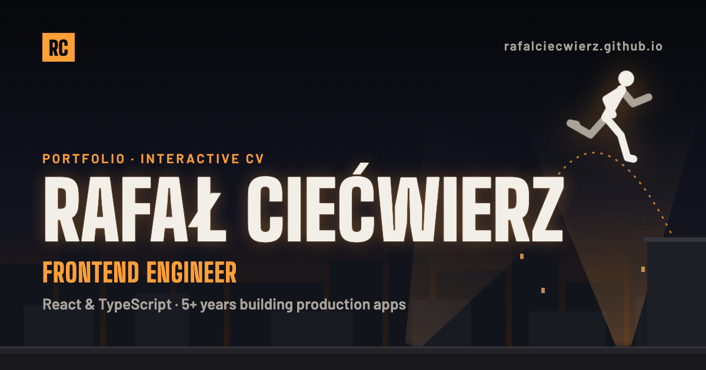

# rafalciecwierz.github.io

[](https://github.com/rafalciecwierz/rafalciecwierz.github.io/actions/workflows/ci.yml)

My portfolio and interactive CV: **[rafalciecwierz.github.io](https://rafalciecwierz.github.io)**.

I'm Rafał Ciećwierz, a frontend engineer (React and TypeScript, 5+ years in production). The site is a parkour night session over the rooftops: my name is a floodlit sign, a free-runner drawn in code lives on it, and my career is a run from roof to roof. It is also a showcase of how I build frontend: a static, fast and accessible page first, with the motion added on top.



## Stack

- **React 19** and **TypeScript**, built with **Vite**, pre-rendered to static HTML at build time
- **SCSS Modules** with design tokens
- **GSAP** with ScrollTrigger and `@gsap/react` for the motion, **Lenis** for smooth scrolling
- **Vitest** and **React Testing Library**, **ESLint**, **Prettier**, **commitlint**
- **GitHub Actions** for CI, **Lighthouse CI**, hosted on **GitHub Pages**

The browser downloads four packages: React, GSAP, `@gsap/react` and Lenis. Every effect (the sign, the runner, the skyline, the career run) is my own code, with no animation or UI library.

## Running it

Node 24 (`.nvmrc`) and pnpm.

```sh
pnpm install
pnpm build && pnpm preview
```

`pnpm build` type-checks, builds and pre-renders the site into `dist/`, and `pnpm preview` serves it. `pnpm dev` starts the dev server, which renders on the client only, without the pre-rendered HTML.

## Architecture in short

**The static page is the whole site.** Every page is rendered to HTML at build time, so the content, headings and meta tags are there before any JavaScript runs ([decision #002](docs/DECISIONS.md)). That HTML is the reduced-motion version of the site: the sign is lit, the runner stands on the "Ł", the career is a plain list. It is complete and readable without JavaScript.

**Motion is a separate layer on top.** Each animation is a client-only component that React loads lazily, after hydration, while the browser is idle, and only when `prefers-reduced-motion` is off ([#005](docs/DECISIONS.md)). It animates the DOM that is already there and never hides content that is already on screen. When the reader switches to reduced motion, the layer unmounts and GSAP reverts the page to its static form. Phones never download the career run, which needs at least 900 px.

**Copy lives in typed TypeScript objects**, not in components ([#007](docs/DECISIONS.md)). Changing a job or adding a project means editing one content file.

The full architecture and its rules: [docs/ARCHITECTURE.md](docs/ARCHITECTURE.md). Every hard-to-reverse choice is in [docs/DECISIONS.md](docs/DECISIONS.md) with the alternatives I rejected.

## Performance

I set the targets before writing any code ([brief, section 8](docs/PROJECT_BRIEF.md)). Measured on 5.11.2026 with Lighthouse CI on an emulated mid-range phone (slow 4G, 4× slower CPU), median of three runs:

| Target | Result |
| --- | --- |
| Lighthouse Performance ≥ 90 | **95** |
| Accessibility, Best Practices, SEO ≥ 95 | **100 / 100 / 100** |
| Initial JavaScript ≤ 150 KB gzipped | **99.3 KB** (React is about 70% of it) |
| All the motion code ≤ 80 KB gzipped, loaded later | **62 KB** |
| No layout shift | **CLS 0** |
| 60 fps scrolling | the career run averages 16.7 ms a frame, with no long tasks (1280 px, 4× slower CPU) |

What got it there:

- **Pre-rendered HTML with the CSS inlined** in a `<style>` tag, so the first paint waits for no extra request ([#011](docs/DECISIONS.md)). The hero heading is the Largest Contentful Paint.
- **GSAP, ScrollTrigger and Lenis load after the page is usable**, which keeps about 50 KB out of the initial bundle ([#005](docs/DECISIONS.md)).
- **The career run uses CSS `position: sticky`**, not a ScrollTrigger pin. The browser holds the stage in place, and GSAP only scrubs a progress value ([#009](docs/DECISIONS.md), [#010](docs/DECISIONS.md)). The pin caused a layout shift, and the sticky version has none.
- **The runner moves without re-rendering React.** GSAP tweens a number, and every frame writes the SVG attributes directly.
- **The skyline is generated at build time** from a seed, so the browser gets finished SVG. Looping animations pause off-screen.
- **Self-hosted, preloaded fonts** and WebP images with set dimensions, so nothing shifts as they load.

Lighthouse CI runs on every pull request and fails it below the targets.

## Quality

- **TypeScript with every type written out**, and ESLint rules that enforce the architecture (file naming, no HTML tags in sections, no hard-coded values), so a review is about design, not style.
- **Tests on the logic that matters:** the pure functions (the runner's poses, the career run's stages), every section rendered from test content, the reduced-motion path, the pre-rendering and the content itself.
- **Accessibility built in:** semantic landmarks, a skip link, visible focus, AA contrast, decorative SVG hidden from screen readers, and a site that works fully with reduced motion and without JavaScript.
- **Every pull request** runs lint, format check, typecheck, tests, build, commitlint and Lighthouse CI. A push to `main` runs the same checks, and the site deploys to GitHub Pages only when they pass.

## How it was made

I wrote the documentation before the code: a brief with requirements and success criteria ([docs/PROJECT_BRIEF.md](docs/PROJECT_BRIEF.md)) and a roadmap of small tasks, each with a "Done when" ([docs/ROADMAP.md](docs/ROADMAP.md)). Then came design research, a discovery session about what fits me, and eight design directions, each built as a dark and a light HTML prototype: **16 prototypes in four days**. I compared them against the brief and chose one, 08 Ascent dark. All 16 are published, as built, in the [prototype gallery](https://rafalciecwierz.github.io/design/).

The site was built with [Claude Code](https://claude.com/claude-code), one roadmap task at a time. I set the requirements and the rules, make every decision and review every change, and every commit is mine. The setup (project rules, skills, a read-only audit subagent, guardrails) is in this repository and described in [docs/AI_USAGE.md](docs/AI_USAGE.md).

## License

The code is [MIT](LICENSE).
